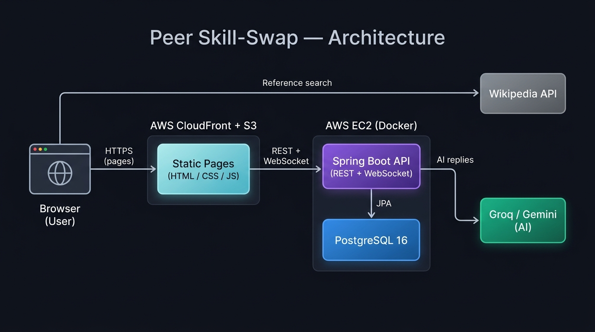
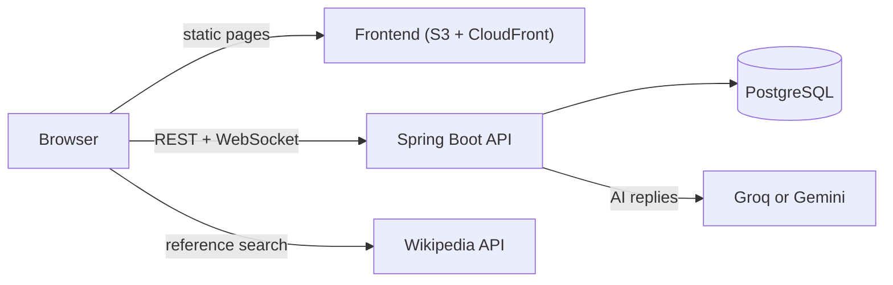

# Peer Skill-Swap Board

A peer-learning platform where students host study sessions, chat live, message each other privately, look up reference material, and study alongside an AI partner.

**Live demo:** https://d2s0xm86wc04ze.cloudfront.net

> The demo runs on AWS using trial credits, so it may occasionally be switched off to save them. There are no shared demo logins: register your own account to try it.

**Video walkthrough:** *(link will be added after recording)*

**Peer Skill-Swap: Dashboard**


**Peer Skill-Swap: Study Room**
<!--
Add screenshots here once you have them, for example:

-->
---

## Features

**Study sessions**
- Host public or private sessions, as a group or one-on-one, tied to a curriculum topic.
- Public sessions are listed on a board. Anyone can send a join request, which the host or an admin approves or declines.
- Private sessions are not listed. People join by invitation (invite by email) or because the host adds them.
- Roles: host, admin and member, with different permissions (see the table below).
- Leave a session at any time. The host can delete a session once everyone else has left.

**Live chat and notifications**
- Persistent chat inside every session, with the full history available to approved members.
- Real-time updates over WebSockets (STOMP over SockJS): new messages appear instantly.
- Pop-up notifications for the things that happen in sessions you belong to: join requests, approvals, invites, removals and new messages.

**Private messaging**
- Message any session member privately from the member list.
- One-on-one conversations and group conversations. A one-on-one chat becomes a group automatically when a third person is added.
- Leaving a conversation removes you from it; the thread keeps going for everyone else.

**AI study partner**
- Start a private chat with "Study Partner (AI)", which explains concepts step by step and asks guiding questions instead of just handing over answers.
- Runs on free-tier LLM providers (Groq and Google Gemini). One is the primary and the other is an automatic fallback.
- Per-user and daily reply limits protect the free quotas.

**Reference resources**
- Each session room has a search panel, pre-filled with the session topic, that pulls article summaries from Wikipedia's public API.

**Other**
- Dark mode with a saved preference.
- Passwords stored as BCrypt hashes.

### Roles and permissions

| Action | Host | Admin | Member |
|---|:---:|:---:|:---:|
| Read and send chat messages | Yes | Yes | Yes |
| Approve or decline join requests | Yes | Yes | No |
| Invite someone by email | Yes | Yes | No |
| Add someone directly by email (no invite step) | Yes | No | No |
| Remove members and other admins | Yes | Yes | No |
| Remove the host | No | No | No |
| Promote a member to admin | Yes | No | No |
| Delete the session (once it is empty) | Yes | No | No |
| Leave the session | No | Yes | Yes |

One-on-one sessions allow a single participant besides the host.

---

## Tech stack

| Layer | Technology |
|---|---|
| Backend | Java 17, Spring Boot 4.1, Spring Web (REST), Spring Data JPA / Hibernate, Bean Validation, Spring WebSocket (STOMP), spring-security-crypto (BCrypt) |
| Database | PostgreSQL 16 |
| Frontend | Plain HTML, CSS and JavaScript, SockJS and STOMP.js (loaded from a CDN) |
| External APIs | Wikipedia API (called from the browser), Groq and Google Gemini (called from the backend) |
| Tooling | Maven, Docker, Docker Compose, Git |
| Hosting | AWS (S3, CloudFront, EC2) |

## Architecture





The backend follows a conventional layered structure: controllers expose the REST endpoints, services hold the business rules (permissions, one-on-one limits, notifications), repositories talk to the database, and DTOs shape what goes over the wire.

## Project structure

```
peer-skill-swap/
├── backend/                         Spring Boot application
│   ├── Dockerfile
│   └── src/main/java/com/wandile/skillswap/
│       ├── config/                  CORS, WebSocket, async and HTTP client setup
│       ├── controller/              REST controllers and the global error handler
│       ├── dto/                     Request and response objects
│       ├── model/                   JPA entities and enums
│       ├── repository/              Spring Data repositories
│       └── service/                 Business logic, notifications, AI providers
├── frontend/                        Static site
│   ├── index.html
│   ├── style.css
│   ├── app.js                       Auth, notifications, rendering
│   ├── sessions.js                  Board, membership, invites
│   ├── chat.js                      Session room chat and member list
│   ├── messages.js                  Private conversations and the AI partner
│   ├── resources.js                 Wikipedia reference panel
│   └── theme.js                     Dark mode
├── docker-compose.yml               Local development stack
├── docker-compose.aws.yml           Production stack for the EC2 server
├── .env.example                     Environment variables to copy into .env
└── README.md
```

---

## Run it locally

**You need:** Docker with Compose, and Python 3 (or any static file server) for the frontend.

```bash
git clone https://github.com/ziyanda-sithole/peer-skill-swap.git
cd peer-skill-swap

# Optional: enable the AI study partner by adding your own free-tier keys
cp .env.example .env

# Start PostgreSQL and the backend (older installs use `docker-compose`)
docker compose up --build
```

The backend is now on `http://localhost:8080`. In a second terminal, serve the frontend:

```bash
cd frontend
python3 -m http.server 5500
```

Open `http://localhost:5500`. When the page is served from localhost, the frontend automatically talks to the backend on port 8080.

The local PostgreSQL container is published on host port `5433`, so it will not clash with a Postgres already running on your machine.

## Configuration

The backend reads its settings from environment variables. Everything has a sensible default except the AI keys.

| Variable | Default | Purpose |
|---|---|---|
| `DB_HOST` | `localhost` | Database host |
| `DB_PORT` | `5432` | Database port |
| `DB_NAME` | `skillswap` | Database name |
| `DB_USER` | `skillswap` | Database user |
| `DB_PASSWORD` | `skillswap` | Database password (always set a strong one in production) |
| `AI_PROVIDER` | `groq` | Primary AI provider: `groq` or `gemini` |
| `GROQ_API_KEY` | empty | Enables the Groq provider |
| `GEMINI_API_KEY` | empty | Enables the Gemini provider |
| `GROQ_MODEL` | `openai/gpt-oss-20b` | Override the Groq model |
| `GEMINI_MODEL` | `gemini-3.1-flash-lite` | Override the Gemini model |

With no AI keys set, the study partner simply replies that it is not switched on. With both keys set, the provider named in `AI_PROVIDER` answers first and the other takes over if it fails or hits its free quota. Never commit a real `.env` file: it is git-ignored, and `.env.example` documents the expected variables.

---

## API overview

Most endpoints take the acting user's id as a query parameter (`userId`, `actingUserId`, `senderId` and so on). See the limitations below.

### Auth and users

| Method | Path | Purpose |
|---|---|---|
| POST | `/api/auth/register` | Create an account |
| POST | `/api/auth/login` | Log in |
| GET | `/api/users/lookup?email=` | Find a user by email |

### Sessions and membership

| Method | Path | Purpose |
|---|---|---|
| POST | `/api/sessions?hostId=` | Create a session |
| GET | `/api/sessions` | List public sessions |
| GET | `/api/sessions/mine?userId=` | Sessions you belong to |
| GET | `/api/sessions/memberships?userId=` | All your memberships, with status |
| GET | `/api/sessions/invites?userId=` | Your pending invites |
| DELETE | `/api/sessions/{id}?actingUserId=` | Delete an empty session (host) |
| POST | `/api/sessions/{id}/join?userId=` | Request to join |
| DELETE | `/api/sessions/{id}/leave?userId=` | Leave a session |
| GET | `/api/sessions/{id}/requests?actingUserId=` | Pending join requests (host or admin) |
| GET | `/api/sessions/{id}/members?userId=` | List members |
| POST | `/api/sessions/{id}/members?actingUserId=` | Add a member directly by email (host) |
| DELETE | `/api/sessions/{id}/members/{userId}?actingUserId=` | Remove a member (host or admin) |
| POST | `/api/sessions/{id}/members/{userId}/approve` | Approve a join request |
| POST | `/api/sessions/{id}/members/{userId}/decline` | Decline a join request |
| POST | `/api/sessions/{id}/members/{userId}/promote` | Promote to admin (host) |
| POST | `/api/sessions/{id}/invite?actingUserId=` | Invite by email |
| POST | `/api/sessions/{id}/invite/accept` and `/decline` | Respond to an invite |

### Messaging

| Method | Path | Purpose |
|---|---|---|
| GET, POST | `/api/sessions/{id}/messages` | Session chat history and sending |
| POST | `/api/conversations/direct` | Start or reopen a one-on-one conversation |
| POST | `/api/conversations/group` | Start a group conversation |
| GET | `/api/conversations/mine?userId=` | Your conversations |
| POST | `/api/conversations/{id}/participants` | Add someone by email |
| DELETE | `/api/conversations/{id}/leave` | Leave a conversation |
| GET, POST | `/api/conversations/{id}/messages` | Conversation history and sending |
| POST | `/api/ai/start?userId=` | Open the chat with the AI study partner |

The original skill-swap endpoints (`/api/posts`, `/api/posts/{id}/respond`, `/api/matches`) are still in the backend, although the current interface no longer uses them.

### Real-time channels

Clients connect to `/ws` (SockJS) and subscribe to:

| Topic | Delivers |
|---|---|
| `/topic/notifications/{userId}` | Personal notifications |
| `/topic/sessions/{sessionId}/chat` | Live session chat messages |
| `/topic/conversations/{conversationId}/messages` | Live private messages |

---

## Deployment

The platform runs entirely on AWS:

- **Pages:** a private S3 bucket served through CloudFront over HTTPS.
- **API and WebSockets:** CloudFront forwards `/api/*` and `/ws/*` to a single EC2 instance, so the browser only talks to one address.
- **Backend and database:** Docker Compose on the instance, using `docker-compose.aws.yml`. PostgreSQL is not published to the internet, and port 8080 only accepts traffic from CloudFront.
- **Secrets:** a `.env` file on the server, never committed.

To ship an update to the AWS version: for backend changes, pull the new code on the server and re-run `docker compose -f docker-compose.aws.yml up -d --build`. For frontend changes, upload the changed files to the bucket and create a CloudFront invalidation for `/*`.

---

## Security and privacy notes

> [!CAUTION]
> **Identity is not token-based yet.** The API trusts the user id in the query string. Anyone who can reach the API endpoint could act as any user. Do not store sensitive personal data on this platform until JWT authentication is in place.

- **Messages are stored in plain text** in the database and are not end-to-end encrypted.
- **AI messages leave the platform.** Anything sent to the study partner is processed by a third-party provider, and free tiers may use submitted content to improve their products. The bot's greeting tells users not to share personal information.
- API keys live only on the server and are never exposed to the browser.

## Known limitations

- The database schema is generated by Hibernate (`ddl-auto=update`). That adds tables and columns but does not widen existing enum constraints, so adding an enum value to an existing table needs a manual SQL change. A migration tool would remove this problem.
- The AI usage limits are counted in memory and reset when the server restarts. The providers' own free-tier quotas are the hard limit.
- There is no meaningful automated test suite or CI pipeline yet.
- The AWS deployment is a single server running on trial credits, with no database backups. Treat its data as disposable.

## Lessons learned

Three engineering problems came up during the build that are worth documenting.

**1. Hibernate and live enum constraints**
Adding a new value to a Java enum and restarting the backend broke the live database. Hibernate's `ddl-auto=update` creates new columns and tables but does not alter existing `CHECK` constraints on enum columns — so the INSERT was rejected. The fix was a manual `ALTER TABLE ... DROP CONSTRAINT ...; ALTER TABLE ... ADD CONSTRAINT ...;` on the running database. The lesson: use a proper migration tool (Flyway or Liquibase) from day one so every schema change is versioned and repeatable.

**2. CORS errors behind CloudFront**
Serving the frontend from S3 and the API from EC2 meant the browser was making cross-origin requests, which the browser blocks unless the server sends the right `Access-Control-Allow-Origin` header. The fix was to route both the static pages and `/api/*` and `/ws/*` through a single CloudFront distribution, so the browser only ever speaks to one origin. CloudFront forwards the right paths to the right origin (S3 or EC2) behind the scenes.

**3. Free AI quota exhaustion**
Free-tier LLM API quotas are small and reset daily. Rather than have the AI feature silently fail, the backend was built with a `LlmProvider` interface and two implementations (Groq and Gemini). If the primary provider fails or returns a rate-limit error, the service retries automatically on the fallback. Per-user and per-day reply limits add a second layer of protection.

## Roadmap

- Token-based authentication (JWT with Spring Security) in place of query-string user ids.
- Automated tests and a CI pipeline.
- Database migrations with Flyway.
- Usernames and profile pages.
- Message pagination, typing indicators and read receipts.
- Moderation and reporting tools for session hosts.

## Troubleshooting

- **CloudFront shows "502 Bad Gateway" for `/api`:** the backend container is not running, or the CloudFront origin is not set to HTTP only on port 8080.
- **Frontend changes do not appear after uploading to S3:** create a CloudFront invalidation for `/*`.
- **Port 5432 is already in use locally:** the Compose file publishes the database on 5433 for this reason. If something else uses 5433, change the left-hand port in `docker-compose.yml`.
- **"Invalid CORS request" when calling the API from a new address:** add that origin to `CorsConfig` in the backend.

---

Built by [@ziyanda-sithole](https://github.com/ziyanda-sithole).

---

WTC-JNAVRWC9